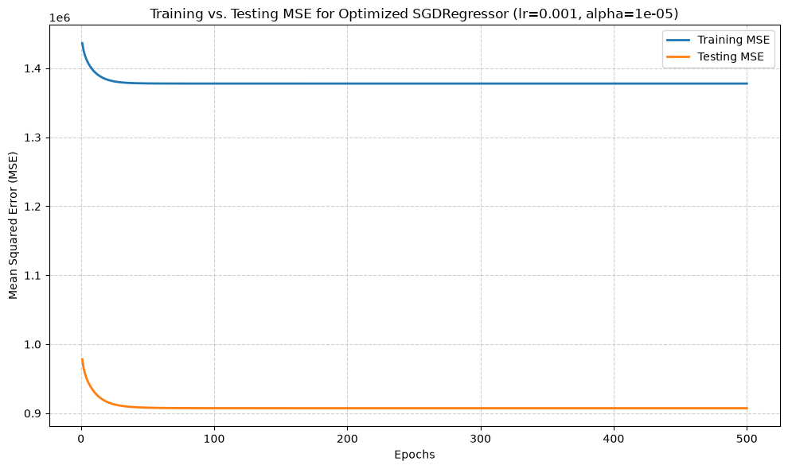
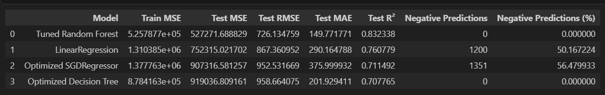
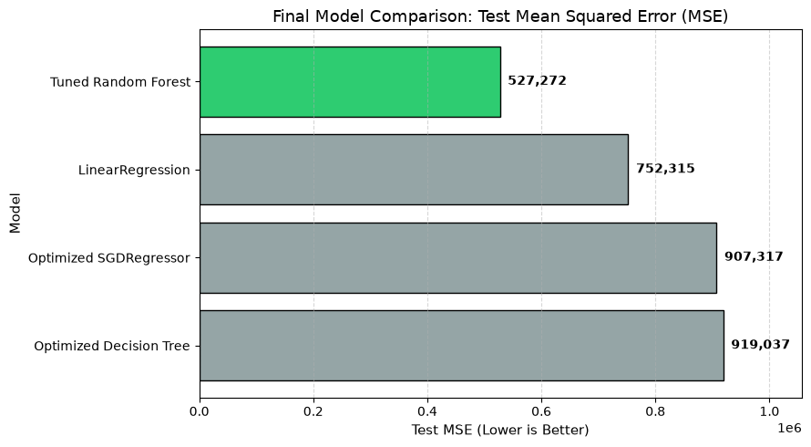
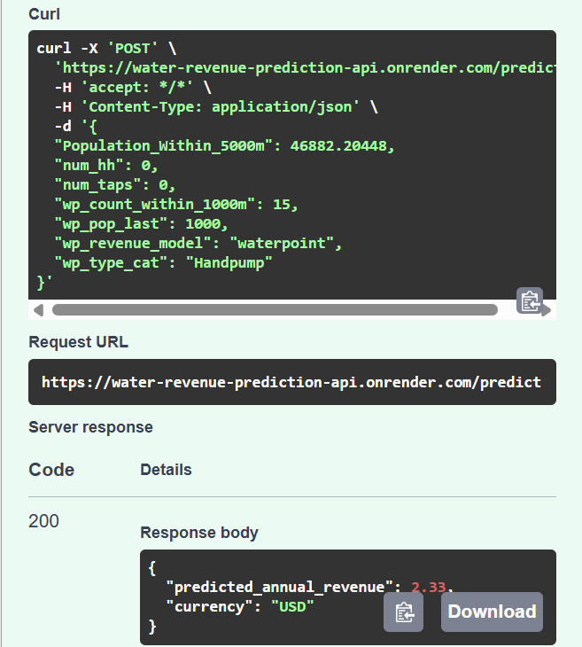
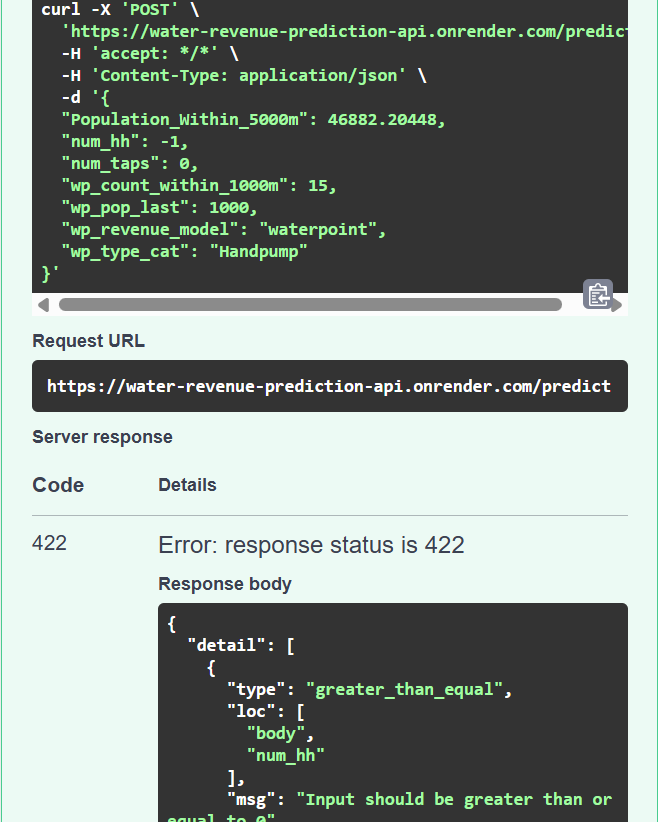
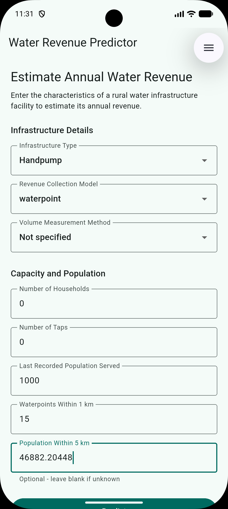
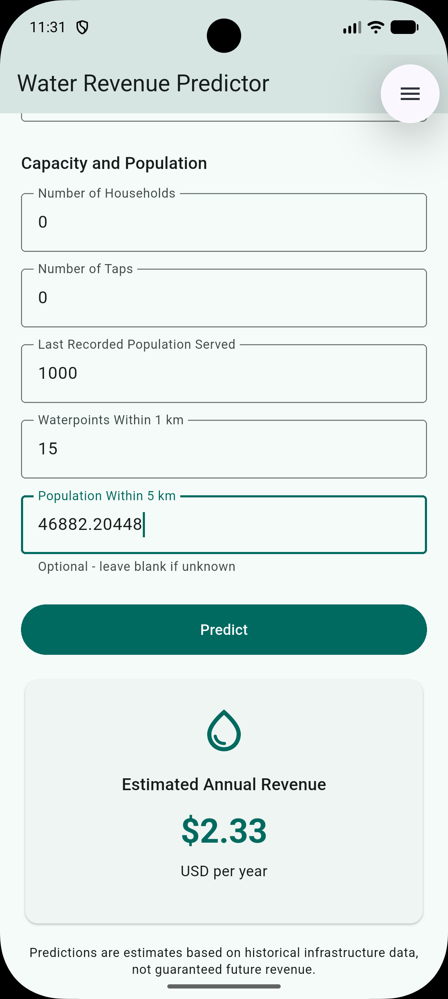

# Rural Water Infrastructure Revenue Prediction

## 1. Mission and Problem Statement
My mission is to leverage data-driven technologies to promote efficient public service delivery, 
contributing to efforts to strengthen good governance in Uganda and across Africa. 
Rural water service providers across Africa face challenges estimating annual revenue,
making financial planning and maintenance difficult. This project uses machine learning to estimate annual
water-service revenue from infrastructure and population characteristics. 

## 2. Dataset Description and Source
- **Dataset:** Revenue and investment data for rural drinking water infrastructure in Africa 2021-2024
- **Source:**  [Dryad](https://datadryad.org/dataset/doi:10.5061/dryad.7pvmcvf7r#readme)
- **Author:** Duncan McNicholl, University of Oxford
- **Target variable:** wp_revenue_USD
-  **Intended Users:** rural water service providers, infrastructure planners, organizations responsible for financial
  planning and maintaining water services

The analysis dataset contains 11,957 observations covering rural water infrastructure characteristics,
revenue collection methods, and population-related indicators

The target, wp_revenue_USD, represents annual water-service revenue in US dollars

Eight input features were selected:

| Feature | Description |
| :--- | :--- |
| wp_type_cat | Infrastructure type |
| wp_revenue_model | Revenue collection model |
| volume_method | Volume measurement method |
| num_hh | Number of households |
| num_taps | Number of taps |
| wp_pop_last | Last recorded population served |
| wp_count_within_1000m | Waterpoints within a 1 km radius |
| Population_Within_5000m | Population within a 5 km radius |

The dataset combines numerical and categorical variables, allowing comparison of linear, tree-based,
and ensemble regression approaches.

## 3. Public API and Swagger Documentation
The trained model is served through a FastAPI application deployed on Render
- [**Swagger UI**](https://water-revenue-prediction-api.onrender.com/docs#/)
- [**API Base URL**](https://water-revenue-prediction-api.onrender.com)
- **Prediction Endpoint:** ```POST /predict```
- **Retraining Endpoint:** ```POST /retrain```
- **Health Check:** ```GET /health```

## 4. Video Demonstration
In progres, coming soon 🚧.....

## 5. How to Run the Flutter Mobile Application
### Prerequisites 
- Flutter SDK
- Android Studio or VS Code with Flutter support
- Android emulator or physical Android device
- Git

### Step 1: Clone the repository
```
  git clone https://github.com/L-nsamba/linear_regression_model.git
  cd linear_regression_model
```

### Step 2: Navigate to the Flutter application
```
  cd summative/FlutterApp/water_revenue_predictor
```

### Step 3: Install dependencies
```
  flutter pub get
```

### Step 4: Connect an Android device
Launch an Android emulator or connect a physical device with USB debugging enabled.
Then verify device availability: 
```
  flutter devices
```

### Step 5: Run the application
```
  flutter run
```

### Step 6: Make a prediction
1. Select an infrastructure type
2. Choose the revenue collection model and volume measurement method
3. Enter the numerical infrastructure and population characteristics
4. Tap **Predict**
5. View the predicted annual revenue directly beneath the button

The application sends the inputs to the public FastAPI endpoint and displays the returned
revenue estimate in USD. Validation and network errors are displayed within the same page

**Note:** Running the Flutter application does not require starting the API locally, provided
the deployed service is available

## 6. Exploratory Data Analysis and Preprocessing
The exploratory analysis investigated feature distributions, missing values, outliers, and relationships
between infrastructure characteristics and annual revenue

### Correlation Analysis


A correlation heatmap was used to examine linear relationships among numerical variables and the revenue target.
Together with the distribution analysis, it informed the selection and interpretation of model predictors

### Feature Distributions
The notebook also examines numerical feature distributions and outliers. Several variables are strongly skewed,
highlighting the importance of evaluating models that can capture nonlinear relationships

The exploratory findings and guided preprocessing and model selection. Full plots, interpretations, and modelling
decisions are documented in the notebook. 
[View the Multivariate Linear Regression Notebook](summative/linear_regression/multivariate.ipynb)

### Preprocessing
The implementation includes:
- Selection of eight predictor variables
- Removal of irrelevant and unsuitable columns
- Handling of missing numerical and categorical values
- Standardization of numerical predictors
- One-hot encoding of categorical predictors
- Splitting data into training, validation, test, and retraining subsets
- Keeping preprocessing fitted exclusively on the appropriate training data

The saved model includes its preprocessing pipeline, ensuring the same transformations are applied
during API predictions

## 7. Regression Models and Evaluation
Four regression alogrithms were implemented using scikit-learn:

| Model | scikit-learn implementation |
| :--- | :--- |
| Closed-form Linear Regression | LinearRegression |
| Gradient Descent Regression | SGDRegressor |
| Decision Tree | DecisionTreeRegressor |
| Random Forest | RandomForestRegressor |

The SGD model was tuned using different learning rates, regularization strengths, and training epochs

### SGD Training Loss


The loss-curve analysis shows how the SGD model's training and evaluation errors change across epochs,
helping assess convergence and the effects of optimization choices

### Model Comparison
All final models were evaluated on the same original held-out test set using Mean Squared Error (MSE),
Mean Absolute Error (MAE),  the coefficient of determination (R²), negative predictions count, and negative prediction percentage



The tuned Random Forest Regressor was selected using validation performance and achieved
the lowest MSE among the four final models

Random Forest is suitable for this dataset because relationships between revenue, infrastructure capacity,
population, and revenue-collection methods may be nonlinear. Its ensemble approach combines multiple
decision trees and can capture interactions that are difficult for linear models to represent

A separate baseline Random Forest configuration performed better on observed test split; however, the
validation-selected model was retained to avoid revising model selection based on the final test results

The selected model and preprocessing pipeline were saved using joblib as:
[Best Model](summative/linear_regression/API/best_model.pkl)

The notebook also contains the single-observation prediction test and the required regression scatter plots

## 8. FastAPI Implementation and Validation
The backend uses FastAPI, Pydantic, pandas, and the serialized scikit-learn pipeline

### Prediction Endpoint
```POST /predict```
The endpoint accepts the eight input variables, validates them using a Pydantic model, and returns the 
predicted annual revenue

Numerical inputs are constrained to non-negative, dataset-informed ranges

| Variable | Accepted range |
| :--- | :--- |
| num_hh | 0–1,000 |
| num_taps | 0–50 |
| wp_pop_last | 0–25,000 |
| wp_count_within_1000m | 0–70 |
| Population_Within_5000m | 0–850,000, or null |

The upper bounds were selected slightly above the observed dataset maxima to accommodate the available
observations while rejecting unusually extreme inputs. They are application-specific limits rather
than universal infrastructure limits

### Successful Swagger Prediction & Input Validation

<table width="300">
  <tr>
    <th colspan="2">FastAPI Validation </th>
  </tr>
  <tr>
    <td width="50%" align="center">
      
    </td>
    <td width="50%" align="center">
      
    </td>
  </tr>
</table>


### CORS Configuration
The API implements FastAPI's CORSMiddleware, explicity defining:
- allow_origins
- allow_methods
- allow_headers
- allow_credentials

Allowed browser origins are restricted to designated development addresses rather than using a wildcard

The API permits the HTTP methods and headers required by its endpoints. Browser credentials are disabled
because the application does not rely on cookie-based sessions

Flutter's native mobile HTTP client is not subject to browser CORS restrictions

## 9. Model Retraining
The API includes an authenticated ```POST /retrain``` endpoint that accepts a CSV file containing labeled
infrastructure observations

Uploading an eligible dataset initiates the retraining procedure without requiring a separate training command

### Retraining Workflow
1. Receive a CSV file and validate the administrative key
2. Verify the uploaded dataset and check for previously processed batches
3. Combine the uploaded observations with the original training records
4. Fit a candidate model
5. Evaluate the candidate and the existing model on the designated validation subset
6. Promote the candidate if validation MSE improves
7. Activate the promoted model for subsequent ```/predict``` requests

**Note:** Because the selected model is Random Forest, retraining involves refitting on the original
training data and uploaded observations rather than using ```partial_fit```

### Retraining Experiment
A batch of 300 genuine labeled observations was withheld before the initial training procedure to simulate
the later arrival of additional data

In the local retraining experiment, 240 observations were incorporated into candidate training, while 60
were used for evaludation

| Metric | Existing Model | Candidate Model |
| :--- | :--- | :--- |
| Validation MSE | 150,248.52 | 138,183.44 |

The candidate achieved approximately 8.03% lower MSE on this retraining evaluation subset

These values should not be compared directly with the original held-out test set results because the evaluation
dataset differ

The API also implements upload-size restrictions, duplicate-batch detection, and protection against overlapping
retraining requests within a single process

**Deployment limitation:** The model retrained during runtime may revert to the committed model after a service restart
or redeployment

## 10. Flutter Application

<table width="100%" align="center">
  <tr>
    <th colspan="2">Prediction Form & Result</th>
  </tr>
  <tr>
    <td width="50%" align="center">
      
    </td>
    <td width="50%" align="center">
      
    </td>
  </tr>
</table>

The tested handpump example returned an estimated annual revenue of $2.33 USD, matching the expected prediction
from the originally deployed model

## 11. Reproducing the Python Environments
The project uses uv for dependency management

Separate pyproject.toml and uv.lock files are provided for the machine learning project and API

### Machine Learning Environment

From the repository root
```
  cd summative
  uv sync --locked
```

This installs the main project's dependencies into its virtual environment

The notebook is available here. [View the Multivariate Linear Regression Notebook](summative/linear_regression/multivariate.ipynb)

### API Environment

From ```summative/```

```
  cd API
  uv sync --locked
```
Start the local API and view from local swagger documentation
```
  uv run --locked uvicorn prediction:app --reload
```

The API also contains a requirements.txt  file exported from its uv environment from Render deployment

To regenerate it from ```summative/API/```
```
  uv export --locked --no-dev --no-hashes --format requirements-txt -o requirements.txt
```

The retraining endpoint requires  the ```RETRAIN_API_KEY``` environment variable.

On Windows, if uv encounters filesystem linking problems, the environment can be synchronized using
```
  uv sync --locked --link-mode=copy
```

## 12. Repository Structure 
```
linear_regression_model/
├── README.md
└── summative/
      ├── pyproject.toml          
      ├── uv.lock         
      ├── linear_regression/
      |      ├── multivariate.ipynb
      |      └── data/
      ├── API/          
      |   ├── prediction.py         
      |   ├── retrain.py
      |   ├── best_model.pkl
      |   ├── uv.lock
      |   ├── requirements.txt
      |   └── data/         
      └── FlutterApp/
```

## 13. Limitations and Future Improvements
- The dataset may not represent every rural water infrastructure context across Africa
- Revenue distributions are highly skewed, and zero-revenue observations present challenges for regression
- Predictions represent estimates rather than guaranteed annual revenue
- Missing values and anonymized dataset fields limit the information available for modelling
- The retraining demonstration uses previously withheld labeled records rather than newly collected field data
- Retraining does not yet maintain a fully cumulative history of all previously updated batches
- Runtime model updates are not permanently stored on the current Render free service
