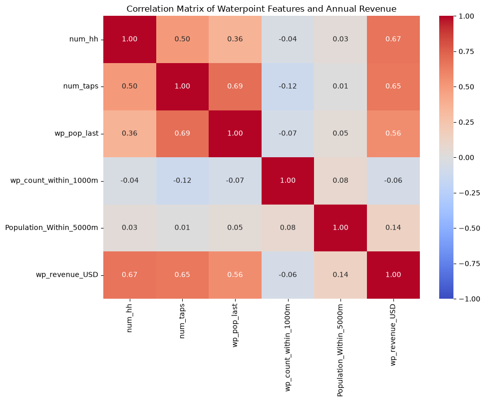

# Rural Water Infrastructure Revenue Prediction

## 1. Mission and Problem Statement
My mission is to leverage data-driven technologies to promote efficient public service delivery, 
contributing to efforts to strengthen good governance in Uganda and across Africa. 
Rural water service providers across Africa face challenges estimating annual revenue,
making financial planning and maintenance difficult. This project uses machine learning to estimate annual
water-service revenue from infrastructure and population characteristics. 

## 2. Dataset Description and Source
- **Dataset:** Revenue and investment data for rural drinking water infrastructure in Africa 2021-2024
- **Source:**  [Dryad](https://datadryad.org/dataset/doi:10.5061/dryad.7pvmcvf7r#readme)
- **Author:** Duncan McNicholl, University of Oxford
- **Target variable:** wp_revenue_USD
-  **Intended Users:** rural water service providers, infrastructure planners, organizations responsible for financial
  planning and maintaining water services

The analysis dataset contains 11,957 observations covering rural water infrastructure characteristics,
revenue collection methods, and population-related indicators

The target, wp_revenue_USD, represents annual water-service revenue in US dollars

Eight input features were selected:

| Feature | Description |
| :--- | :--- |
| wp_type_cat | Infrastructure type |
| wp_revenue_model | Revenue collection model |
| volume_method | Volume measurement method |
| num_hh | Number of households |
| num_taps | Number of taps |
| wp_pop_last | Last recorded population served |
| wp_count_within_1000m | Waterpoints within a 1 km radius |
| Population_Within_5000m | Population within a 5 km radius |

The dataset combines numerical and categorical variables, allowing comparison of linear, tree-based,
and ensemble regression approaches.

## 3. Public API and Swagger Documentation
The trained model is served through a FastAPI application deployed on Render
- [**Swagger UI**](https://water-revenue-prediction-api.onrender.com/docs#/)
- [**API Base URL**](https://water-revenue-prediction-api.onrender.com)
- **Prediction Endpoint:** ```POST /predict```
- **Retraining Endpoint:** ```POST /retrain```
- **Health Check:** ```GET /health```

## 4. Video Demonstration
In progres, coming soon 🚧.....

## 5. How to Run the Flutter Mobile Application
### Prerequisites 
- Flutter SDK
- Android Studio or VS Code with Flutter support
- Android emulator or physical Android device
- Git

### Step 1: Clone the repository
```
  git clone https://github.com/L-nsamba/linear_regression_model.git
  cd linear_regression_model
```

### Step 2: Navigate to the Flutter application
```
  cd summative/FlutterApp/water_revenue_predictor
```

### Step 3: Install dependencies
```
  flutter pub get
```

### Step 4: Connect an Android device
Launch an Android emulator or connect a physical device with USB debugging enabled.
Then verify device availability: 
```
  flutter devices
```

### Step 5: Run the application
```
  flutter run
```

### Step 6: Make a prediction
1. Select an infrastructure type
2. Choose the revenue collection model and volume measurement method
3. Enter the numerical infrastructure and population characteristics
4. Tap **Predict**
5. View the predicted annual revenue directly beneath the button

The application sends the inputs to the public FastAPI endpoint and displays the returned
revenue estimate in USD. Validation and network errors are displayed within the same page

**Note:** Running the Flutter application does not require starting the API locally, provided
the deployed service is available

## 6. Exploratory Data Analysis and Preprocessing
The exploratory analysis investigated feature distributions, missing values, outliers, and relationships
between infrastructure characteristics and annual revenue

### Correlation Analysis

A correlation heatmap was used to examine linear relationships among numerical variables and the revenue target.
Together with the distribution analysis, it informed the selection and interpretation of model predictors

### Feature Distributions
The notebook also examines numerical feature distributions and outliers. Several variables are strongly skewed,
highlighting the importance of evaluating models that can capture nonlinear relationships

The exploratory findings and guided preprocessing and model selection. Full plots, interpretations, and modelling
decisions are documented in the notebook. 
[View the Multivariate Linear Regression Notebook](summative/linear_regression/multivariate.ipynb)

### Preprocessing
The implementation includes:
- Selection of eight predictor variables
- Removal of irrelevant and unsuitable columns
- Handling of missing numerical and categorical values
- Standardization of numerical predictors
- One-hot encoding of categorical predictors
- Splitting data into training, validation, test, and retraining subsets
- Keeping preprocessing fitted exclusively on the appropriate training data

The saved model includes its preprocessing pipeline, ensuring the same transformations are applied
during API predictions

## 7. Regression Models and Evaluation
Four regression alogrithms were implemented using scikit-learn:

| Model | scikit-learn implementation |
| :--- | :--- |
| Closed-form Linear Regression | LinearRegression |
| Gradient Descent Regression | SGDRegressor |
| Decision Tree | DecisionTreeRegressor |
| Random Forest | RandomForestRegressor |

The SGD model was tuned using different learning rates, regularization strengths, and training epochs

### SGD Training Loss


The loss-curve analysis shows how the SGD model's training and evaluation errors change across epochs,
helping assess convergence and the effects of optimization choices

### Model Comparison
All final models were evaluated on the same original held-out test set using Mean Squared Error (MSE),
Mean Absolute Error (MAE), and the coefficient of determination (R²)


